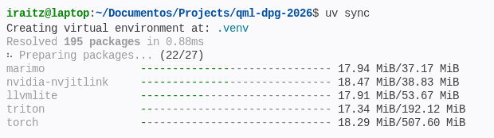
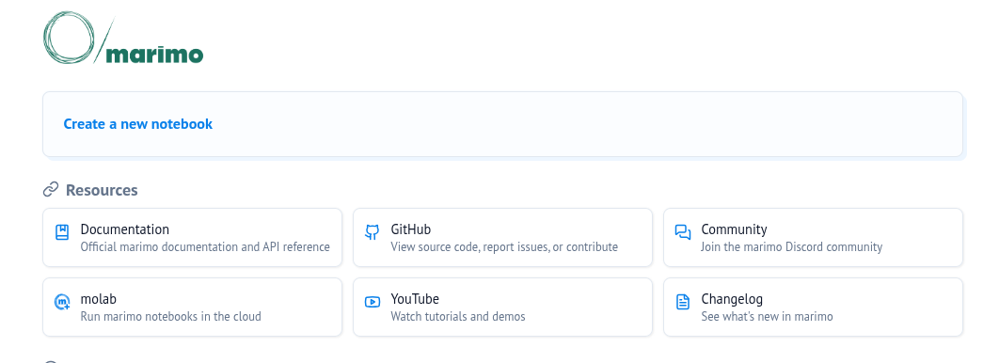
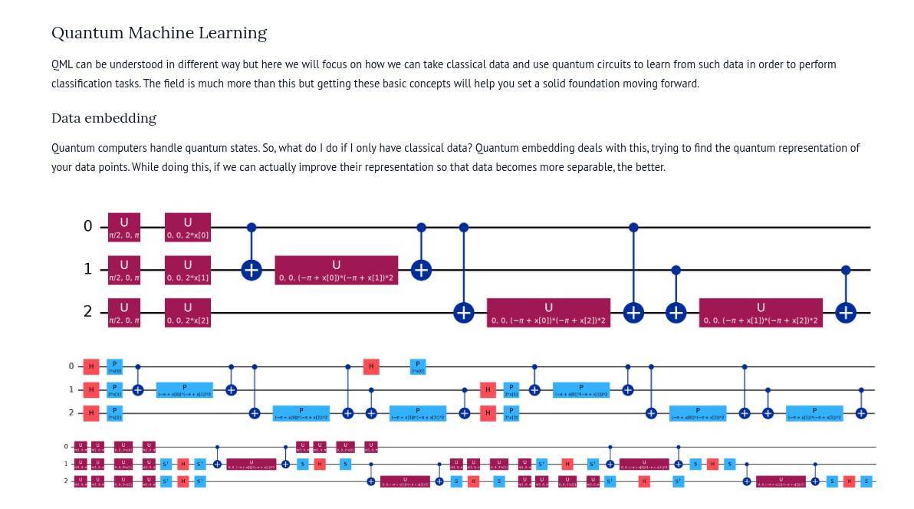
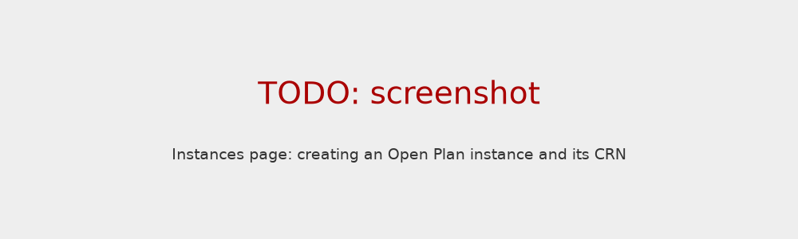

# Getting started

A short reference for setting up this repository locally and running the notebooks.
If you would rather not install anything, every notebook has an **Open in molab** or
**Open In Colab** badge in the [README](README.md), those run in the browser.

- [1. Clone the repository](#1-clone-the-repository)
- [2. Set up the environment with uv](#2-set-up-the-environment-with-uv)
- [3. Run the notebooks with marimo](#3-run-the-notebooks-with-marimo)
- [4. Register in IBM Quantum Platform](#4-register-in-ibm-quantum-platform)
- [Troubleshooting](#troubleshooting)

## 1. Clone the repository

You need [git](https://git-scm.com/downloads) installed.

```bash
git clone -b variant/ibm https://github.com/IraitzM/qml-dpg-2026.git
cd qml-dpg-2026
```

This is the IBM flavour of the workshop, it lives in the `variant/ibm` branch. The `main` branch runs Session 2 on IQM hardware instead.

If you plan to keep your own changes, fork the repository on GitHub first and clone your fork instead, that way you can commit and push freely.

> The `data/` folder (MNIST) is git-ignored and downloaded on demand by the Session 3
> notebooks, so a fresh clone is small.

## 2. Set up the environment with uv

We use [uv](https://docs.astral.sh/uv/) as the package and Python manager. It resolves dependencies from `pyproject.toml`, pins them in `uv.lock`, and can install the right Python version for you (no `conda`, no manual `venv`).

### Install uv

```bash
# macOS / Linux
curl -LsSf https://astral.sh/uv/install.sh | sh

# Windows (PowerShell)
powershell -ExecutionPolicy ByPass -c "irm https://astral.sh/uv/install.ps1 | iex"
```

Check it worked:

```bash
uv --version
```

### Create the environment

From the repository root:

```bash
uv sync
```

This reads `pyproject.toml` + `uv.lock`, downloads Python 3.12 if you don't have it, and creates a `.venv/` folder with every dependency at the exact locked version.



> **Heads-up:** this pulls in `torch`, `pennylane-lightning-gpu` and friends, so the
> first sync downloads a few GB and takes a while. Later runs are cached and instant.

### Working with the environment

You don't need to activate anything, prefix commands with `uv run`:

```bash
uv run marimo edit
```

If you prefer an activated shell (or your IDE needs one), point it at `.venv`:

```bash
source .venv/bin/activate      # macOS / Linux
.venv\Scripts\activate         # Windows
```

Useful commands:

| Command | What it does |
| --- | --- |
| `uv sync` | Install/update the environment to match `uv.lock` |
| `uv run <cmd>` | Run `<cmd>` inside the environment |
| `uv add <package>` | Add a dependency (updates `pyproject.toml` and `uv.lock`) |
| `uv remove <package>` | Drop a dependency |
| `uv lock --upgrade` | Re-resolve to newer versions, then `uv sync` |
| `uv tree` | Show the dependency tree |

## 3. Run the notebooks with marimo

The notebooks live as **`.py` files**. Those are the [marimo](https://marimo.io) notebooks, and they are the source of truth. The matching `.ipynb` files are exports kept around so the Colab badges work.

marimo notebooks are reactive: change a cell and every cell that depends on it re-runs automatically. Because they are plain Python, they also diff cleanly in git.

### `marimo edit` : the interactive editor

Launch the notebook browser (a file explorer of all notebooks in the repo):

```bash
uv run marimo edit
```

Or open one notebook directly. Quote the path, the folder names contain a space:

```bash
uv run marimo edit "Session 1/1.1-Getting the basics.py"
```

marimo starts a local server and opens your browser at `http://localhost:2718`.



Handy flags:

```bash
uv run marimo edit --port 8080          # pick the port
uv run marimo edit --headless           # don't auto-open a browser
uv run marimo edit --watch <file.py>    # pick up edits made in your IDE
```

### `marimo run` : read-only app mode

Same notebook, but the code is hidden and you only see the outputs and widgets. This is the mode to use when presenting:

```bash
uv run marimo run "Session 1/1.3-QML.py"
```



## 4. Register in IBM Quantum Platform

[IBM Quantum Platform](https://quantum.cloud.ibm.com/) is the cloud service that gives access to IBM's superconducting devices, the 156 qubit **Heron** processors (`ibm_fez`, `ibm_marrakesh`, `ibm_kingston`, ...).

You need an account, an API key and an instance for the **Session 2** notebooks; Sessions 1 and 3 run fully on simulators and need none of this. Even Session 2 can run without an account, see [Working without an account](#working-without-an-account).

### Create the account

1. Go to **<https://quantum.cloud.ibm.com/>** and sign up with an IBMid (or create one).
2. Confirm your email and complete the profile details.


### Create an Open Plan instance

An _instance_ is what your jobs get billed against. The **Open Plan** is free and gives you 10 minutes of QPU time every 28 days.

1. From the dashboard, open **Instances** and click **Create instance**.
2. Pick the **Open Plan**, give it a name and create it.
3. Copy its **CRN** (a long string starting with `crn:v1:bluemix:...`). You will need it next to the API key.



Once you are in, the dashboard lists the devices your instance can use, their status and queue, and your recent jobs.


### Generate an API key

From the dashboard, find the **API key** panel and create a new key.


> **Copy it immediately.** The key is shown only once, at creation time. If you lose it, delete it and create a new one.

### Use the key

The Session 2 notebooks read the key from the `QISKIT_IBM_TOKEN` environment variable and the instance from `QISKIT_IBM_INSTANCE`. If they are not set, the notebooks prompt for them with `getpass` so nothing is written to disk:

```python
import os
from getpass import getpass

os.environ["QISKIT_IBM_TOKEN"] = getpass("Here goes your IBM Quantum API key:")
os.environ["QISKIT_IBM_INSTANCE"] = getpass("And your instance CRN (leave it empty to use any of yours):")
```

Then the connection itself:

```python
from qiskit_ibm_runtime import QiskitRuntimeService

service = QiskitRuntimeService(
    channel="ibm_quantum_platform",
    token=os.environ["QISKIT_IBM_TOKEN"],
    instance=os.environ.get("QISKIT_IBM_INSTANCE") or None,
)
backend = service.least_busy(operational=True, simulator=False)   # or service.backend("ibm_fez")
print(f"Connected to : {backend.name}")
```

If you would rather not retype them every session, export both in your shell before launching marimo:

```bash
# macOS / Linux
export QISKIT_IBM_TOKEN="your-api-key-here"
export QISKIT_IBM_INSTANCE="crn:v1:bluemix:..."
uv run marimo edit

# Windows PowerShell
$env:QISKIT_IBM_TOKEN = "your-api-key-here"
$env:QISKIT_IBM_INSTANCE = "crn:v1:bluemix:..."
uv run marimo edit
```

> **Never commit your API key.** `.env` is git-ignored in this repo, keep it there or in your shell profile, and don't paste it into a notebook cell that gets saved.

### Watch your QPU time

The Open Plan gives you **10 minutes of QPU time per rolling 28 day window**. That sounds small, but the circuits in this workshop take a few seconds each. What adds up is the fixed overhead per job, so the notebooks send several circuits in a single job whenever they can. Check the remaining time in the **Instances** page before launching anything large.


Two more things to know about the Open Plan:

- Jobs wait in a shared queue, which may take from seconds to hours depending on the device and the time of day. `least_busy` helps, and you can follow your jobs in the [workloads page](https://quantum.cloud.ibm.com/workloads).
- Only _job_ and _batch_ execution modes are allowed. _Sessions_ (which reserve a device for you) are not, that is why notebook 2.3 hands sQUlearn a `Batch`.

### Working without an account

Every Session 2 notebook has a `USE_FAKE` flag at the top of the connection cells. Set it to `True` and the notebook runs against `FakeFez`, a local simulator that copies the topology, native gates and calibration data of the real `ibm_fez`. No account, no queue, no QPU time. A sensible workflow is to go through a notebook with `USE_FAKE = True` first and switch to the real device once everything works.

Keep in mind that IBM's server side error mitigation options (dynamical decoupling, ZNE, TREX) are ignored when running locally.

## Troubleshooting

**`uv sync` fails on `pennylane-lightning-gpu`**: that wheel expects a CUDA-capable machine. On a laptop without an NVIDIA GPU, drop it: `uv remove pennylane-lightning-gpu`.
The notebooks fall back to the CPU `lightning.qubit` device.

**`marimo: command not found`**: you are outside the environment. Use `uv run marimo …` or activate `.venv` first.

**Port 2718 already in use**: a previous marimo server is still alive. Either stop it or pass `--port` with a free one.

**Paths with spaces**: the session folders are `Session 1`, `Session 2`, `Session 3`.
Always quote them: `uv run marimo edit "Session 2/2.1-Running on hardware.py"`.

**`401` / authentication errors against IBM Quantum Platform**: the API key is missing, revoked, or stored under the wrong name. The variables must be `QISKIT_IBM_TOKEN` and `QISKIT_IBM_INSTANCE`. Restart the notebook kernel (the prompt only shows up when the variable is not set yet) and check the key still exists in the dashboard.

**Instance not found / no backends available**: the CRN is wrong or belongs to another account. Copy it again from the **Instances** page, or leave it empty and let the service use any instance you have access to.

**Errors mentioning sessions on the Open Plan**: something tried to open a Runtime `Session`. Use job mode (`Sampler(mode=backend)`) or a `Batch` instead.

**Jobs queued for a long time**: that's the shared Open Plan queue. Switch to `USE_FAKE = True` to keep going and come back for the results later, jobs keep running even if you close the notebook.
